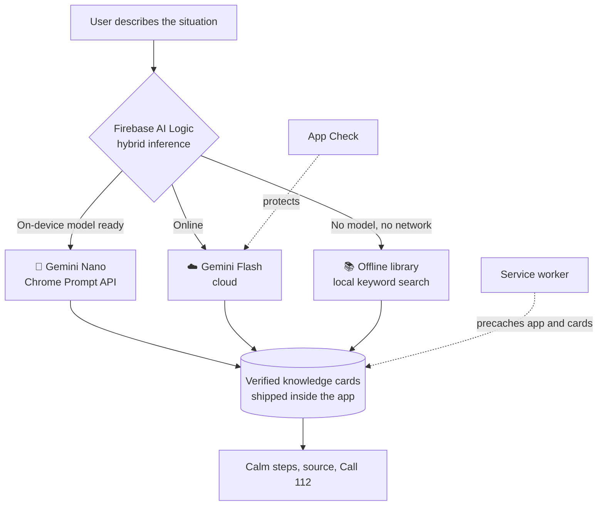

# Lifeline

An offline-first hybrid AI disaster assistant, built for the
[Firebase #BuildHybridAI 2026](https://firebasehybridaihackathon.devpost.com/)
hackathon.

In the first hours after a major earthquake, mobile networks often fail. That is
when people most need calm, trustworthy guidance, and when cloud AI stops
working. Lifeline is a Progressive Web App that keeps answering when the network
does not. See [docs/IDEA.md](docs/IDEA.md).

> **Status:** infrastructure skeleton. The repository holds only research, setup,
> and one hybrid test page. Core features start on 9 November 2026, as planned in
> [docs/ROADMAP.md](docs/ROADMAP.md). This app gives no emergency guidance yet.
> In an emergency, call 112.

## How it works

Every question goes to the best layer that is available on the device. The app
always tells the user which layer answered.



The model selects a card and does not write medical instructions. This design
keeps guidance grounded on every layer.

### Where each layer runs

Facts checked on 4 November 2026. Sources are in
[docs/RESEARCH.md](docs/RESEARCH.md).

| Device | Online | Offline |
| --- | --- | --- |
| Desktop Chrome, capable hardware | ☁️ or 📱 | 📱 Gemini Nano |
| Phone (Android or iOS) | ☁️ Gemini Flash | 📚 Offline library |
| Any other browser | ☁️ Gemini Flash | 📚 Offline library |

Chrome does not support Gemini Nano on Android or iOS yet, and the Prompt API
does not accept Turkish yet. The research document explains how the design
handles both limits.

## Tech stack

- [Vite](https://vite.dev/) and TypeScript, with no UI framework
- [vite-plugin-pwa](https://vite-pwa-org.netlify.app/) for the service worker
- [Firebase AI Logic](https://firebase.google.com/docs/ai-logic) for hybrid inference
- [Firebase App Check](https://firebase.google.com/docs/app-check) with reCAPTCHA Enterprise
- [Firebase Hosting](https://firebase.google.com/docs/hosting)

## Getting started

You need Node.js 22 or later.

```bash
git clone https://github.com/erkambbb/lifeline-hybrid-ai.git
cd lifeline-hybrid-ai
npm install
npm run dev
```

Open <http://localhost:5173>. The on-device path works without a Firebase
project. To enable the cloud path, follow
[docs/FIREBASE_SETUP.md](docs/FIREBASE_SETUP.md).

To test offline behavior, use a production build. The service worker is off in
dev mode.

```bash
npm run build
npm run preview
```

### On-device requirements

Chrome on Windows, macOS, Linux, or a Chromebook Plus, with at least 22 GB of
free disk space. It also needs a GPU with more than 4 GB of VRAM, or 16 GB of RAM
and 4 CPU cores. See the
[Chrome documentation](https://developer.chrome.com/docs/ai/get-started).

The GPU also needs enough free memory when the model loads. Close heavy GPU apps
if you see `InvalidStateError: The device is unable to create a session`.

## Project structure

```text
src/firebase.ts    Firebase and App Check setup
src/hybrid.ts      Hybrid model, on-device status, source detection
src/main.ts        Test page and service worker registration
vite.config.ts     PWA manifest and precache rules
firebase.json      Hosting configuration
docs/              Idea, research, setup, roadmap, learning plan
```

## Security

No secret belongs in this repository. Real values go in `.env.local`, which git
ignores. [docs/FIREBASE_SETUP.md](docs/FIREBASE_SETUP.md) explains why the Firebase
web config can be public and why App Check is still required.

## License

The code is released under the [MIT License](LICENSE).

The MIT License will not cover the emergency content that is added later. That
content will carry its own attribution and terms, because some of its sources
permit non-commercial use only.
